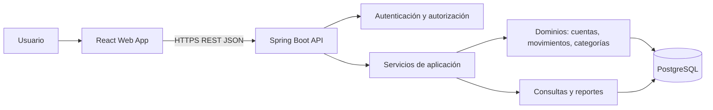

# Software Architecture Document (SAD)

| Campo | Valor |
|---|---|
| Identificador | MON-DOC-006 |
| Versión | 1.0 |
| Estado | Arquitectura propuesta |
| Estilo | Monolito modular |

## 1. Objetivo

Definir una arquitectura simple, segura y mantenible para un MVP desarrollado por una persona y con presupuesto objetivo cero.

## 2. Decisión arquitectónica principal

Se propone un **monolito modular**: un backend Spring Boot desplegable como una sola aplicación, organizado por módulos de dominio. No se recomiendan microservicios para el MVP porque añadirían complejidad operativa, despliegue y observabilidad sin una necesidad demostrada.

## 3. Stack propuesto

| Capa | Tecnología |
|---|---|
| Frontend | React + TypeScript |
| Build frontend | Vite |
| UI | Librería de componentes a elección del desarrollador |
| Backend | Java LTS + Spring Boot |
| API | REST / JSON |
| Seguridad | Spring Security |
| Persistencia | PostgreSQL |
| Acceso a datos | Spring Data JPA |
| Migraciones | Flyway |
| Validación | Jakarta Bean Validation |
| Pruebas backend | JUnit, Mockito, Spring Boot Test |
| Pruebas frontend | Vitest y Testing Library |
| E2E | Playwright, si el tiempo lo permite |
| Control de versiones | Git / GitHub |

Las versiones exactas deben elegirse al iniciar el proyecto, usando versiones estables compatibles y registrándolas en el build.

## 4. Vista lógica



## 5. Módulos backend

Organizar por funcionalidad, no por capas globales gigantes:

```text
com.moneta
├── MonetaApplication
├── shared
│   ├── config
│   ├── exception
│   └── security
├── identity
│   ├── api
│   ├── application
│   ├── domain
│   └── infrastructure
├── account
├── category
├── transaction
├── dashboard
├── recurring
└── budget
```

Los módulos `recurring` y `budget` pueden incorporarse en P1. Evitar crear paquetes vacíos antes de necesitarlos.

## 6. Organización frontend

```text
src/
├── app/
│   ├── router/
│   ├── providers/
│   └── layouts/
├── features/
│   ├── auth/
│   ├── accounts/
│   ├── categories/
│   ├── transactions/
│   ├── dashboard/
│   ├── recurring/
│   └── budgets/
├── shared/
│   ├── components/
│   ├── hooks/
│   ├── services/
│   ├── types/
│   └── utils/
└── styles/
```

## 7. Principios

1. El backend es la autoridad para autorización, reglas de negocio y cálculo de saldos.
2. El frontend nunca decide la propiedad de un recurso.
3. No confiar en `userId` enviado por el cliente para definir el propietario; derivarlo de la identidad autenticada.
4. Los importes se manejan con `BigDecimal` en Java y tipos adecuados en el cliente.
5. Operaciones financieras se ejecutan dentro de transacciones de base de datos.
6. Usar migraciones versionadas; no depender de `ddl-auto=update` en entornos compartidos/producción.
7. Separar DTOs de entidades JPA.
8. Evitar exponer entidades directamente en respuestas REST.
9. Mantener dependencias y servicios externos al mínimo.

## 8. Seguridad

- Spring Security protege endpoints privados.
- Elegir una estrategia de sesión/token antes de codificar autenticación. Para SPA propia, evaluar cookie segura `HttpOnly`, `Secure`, `SameSite` frente a bearer token; no guardar JWT sensible en `localStorage` sin análisis de riesgo.
- Contraseñas con BCrypt o Argon2id.
- CORS limitado al origen frontend.
- Protección CSRF según estrategia de autenticación.
- Rate limiting para autenticación si el hosting lo permite.
- Validar propietario en cada operación.
- Secretos por variables de entorno.
- No registrar tokens, contraseñas ni payloads financieros completos.
- Política de privacidad y proceso de eliminación antes de beta pública.

## 9. Despliegue y presupuesto

Desarrollo local primero. Para beta, evaluar proveedores que ofrezcan cuotas gratuitas vigentes para frontend, backend y PostgreSQL. No asumir que un plan gratuito es permanente ni que permite producción confiable. Mantener instrucciones para desplegar en otro proveedor.

## 10. Entornos

- `local`: desarrollo individual.
- `test`: pruebas automatizadas.
- `production`: beta pública o privada.

Configuración por variables de entorno. Mantener `.env.example` sin secretos.

## 11. Observabilidad y operación

- Logs estructurados.
- Health check.
- Manejo global de excepciones.
- Backups documentados.
- Migraciones reversibles o plan de restauración.
- Alertas básicas si el proveedor las ofrece.

## 12. Riesgos arquitectónicos

| Riesgo | Respuesta |
|---|---|
| Complejidad prematura | Monolito modular |
| Saldos desincronizados | Transacciones y pruebas de invariantes |
| Fuga de datos entre usuarios | Autorización en servidor y pruebas negativas |
| Costos inesperados | Revisar límites y alertas del proveedor |
| Dependencia de proveedor | Portabilidad PostgreSQL y variables estándar |

## 13. Decisiones pendientes

- Java y Spring Boot exactos.
- Estrategia de autenticación SPA.
- Hosting y proveedor PostgreSQL.
- Moneda única o multimoneda.
- Política de saldo negativo.
- Estrategia de eliminación/auditoría de movimientos.
