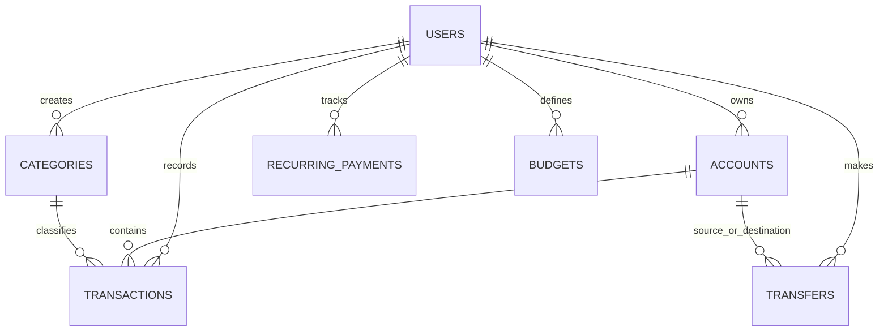

# Data Model — Moneta

| Campo | Valor |
|---|---|
| Identificador | MON-DOC-007 |
| Versión | 1.0 |
| Estado | Modelo lógico propuesto |

## 1. Principios

- UUID como identificador público.
- Todas las tablas de negocio tienen propietario o se relacionan con un recurso que tiene propietario.
- Importes como `NUMERIC/DECIMAL`, nunca `FLOAT` o `DOUBLE`.
- Fechas de evento separadas de fechas de creación/actualización.
- Las entidades financieras no deben borrarse en cascada accidentalmente.
- PostgreSQL es la fuente de verdad.

## 2. Entidades

### users

| Campo | Tipo sugerido | Regla |
|---|---|---|
| id | UUID | PK |
| email | VARCHAR(254) | Único, normalizado |
| password_hash | VARCHAR(255) | Obligatorio |
| display_name | VARCHAR(100) | Obligatorio |
| created_at | TIMESTAMPTZ | Obligatorio |
| updated_at | TIMESTAMPTZ | Obligatorio |
| status | VARCHAR(20) | ACTIVE / DISABLED |

### accounts

| Campo | Tipo sugerido | Regla |
|---|---|---|
| id | UUID | PK |
| user_id | UUID | FK users |
| name | VARCHAR(80) | Obligatorio |
| account_type | VARCHAR(30) | CASH / BANK / WALLET / OTHER |
| currency_code | CHAR(3) | Código ISO 4217 |
| opening_balance | NUMERIC(19,4) | Saldo inicial |
| archived_at | TIMESTAMPTZ | Nullable |
| created_at | TIMESTAMPTZ | Obligatorio |
| updated_at | TIMESTAMPTZ | Obligatorio |

El saldo actual puede calcularse desde saldo inicial + movimientos, o mantenerse como valor derivado/cacheado. Para el MVP se recomienda calcularlo desde el ledger al inicio por simplicidad y consistencia; si se materializa por rendimiento, debe existir una estrategia de reconciliación.

### categories

| Campo | Tipo sugerido | Regla |
|---|---|---|
| id | UUID | PK |
| user_id | UUID | FK nullable si es global |
| name | VARCHAR(60) | Obligatorio |
| category_type | VARCHAR(20) | INCOME / EXPENSE |
| is_system | BOOLEAN | Indica categoría inicial |
| created_at | TIMESTAMPTZ | Obligatorio |

Restricción: unicidad por usuario, nombre normalizado y tipo. Definir política de categorías globales frente a categorías propias.

### transactions

| Campo | Tipo sugerido | Regla |
|---|---|---|
| id | UUID | PK |
| user_id | UUID | FK users |
| account_id | UUID | FK accounts |
| category_id | UUID | FK categories, nullable para transferencia |
| transaction_type | VARCHAR(20) | INCOME / EXPENSE |
| amount | NUMERIC(19,4) | > 0 |
| currency_code | CHAR(3) | Igual a moneda de cuenta |
| occurred_at | TIMESTAMPTZ | Fecha del movimiento |
| description | VARCHAR(250) | Nullable |
| created_at | TIMESTAMPTZ | Obligatorio |
| updated_at | TIMESTAMPTZ | Obligatorio |
| deleted_at | TIMESTAMPTZ | Nullable, si se usa borrado lógico |

### transfers

| Campo | Tipo sugerido | Regla |
|---|---|---|
| id | UUID | PK |
| user_id | UUID | FK users |
| source_account_id | UUID | FK accounts |
| destination_account_id | UUID | FK accounts |
| amount | NUMERIC(19,4) | > 0 |
| currency_code | CHAR(3) | Igual en ambas cuentas |
| occurred_at | TIMESTAMPTZ | Fecha |
| description | VARCHAR(250) | Nullable |
| created_at | TIMESTAMPTZ | Obligatorio |

Transferencias separadas de ingresos/gastos para evitar que distorsionen reportes. Debe ser atómica y validar ambas cuentas.

### recurring_payments (P1)

| Campo | Tipo sugerido | Regla |
|---|---|---|
| id | UUID | PK |
| user_id | UUID | FK users |
| account_id | UUID | FK accounts nullable |
| category_id | UUID | FK categories nullable |
| name | VARCHAR(100) | Obligatorio |
| amount | NUMERIC(19,4) | > 0 |
| currency_code | CHAR(3) | Código ISO |
| frequency | VARCHAR(20) | WEEKLY / MONTHLY / YEARLY |
| next_due_date | DATE | Obligatorio |
| status | VARCHAR(20) | ACTIVE / PAUSED / CANCELLED |
| created_at | TIMESTAMPTZ | Obligatorio |

El registro no representa un cobro real. No crear movimientos automáticamente hasta definir la política de confirmación.

### budgets (P1)

| Campo | Tipo sugerido | Regla |
|---|---|---|
| id | UUID | PK |
| user_id | UUID | FK users |
| category_id | UUID | FK categories |
| period_start | DATE | Inicio |
| period_end | DATE | Fin |
| limit_amount | NUMERIC(19,4) | > 0 |
| currency_code | CHAR(3) | Código ISO |

## 3. Relaciones

## 4. Invariantes

1. `amount > 0`.
2. `account.user_id = transaction.user_id`.
3. `source_account.user_id = transfer.user_id`.
4. `destination_account.user_id = transfer.user_id`.
5. `source_account_id != destination_account_id`.
6. Moneda del movimiento coincide con moneda de cuenta.
7. Ambas cuentas de transferencia tienen la misma moneda.
8. Categoría compatible con el tipo de movimiento.
9. No se permite sumar balances de monedas distintas.
10. Una transferencia debe persistirse completa o no persistirse.

## 5. Cálculo de saldos

Para una cuenta:

`balance = opening_balance + SUM(income) - SUM(expense) - SUM(transfer_out) + SUM(transfer_in)`

La fórmula debe considerar únicamente movimientos no anulados/no eliminados y respetar la moneda de la cuenta.

## 6. Índices recomendados

- `users(email)` UNIQUE.
- `accounts(user_id, archived_at)`.
- `transactions(user_id, occurred_at DESC)`.
- `transactions(account_id, occurred_at DESC)`.
- `transactions(user_id, category_id, occurred_at)`.
- `transfers(user_id, occurred_at DESC)`.
- `recurring_payments(user_id, next_due_date)` para P1.

## 7. Pendientes

- Confirmar si se soportará multimoneda.
- Definir escala decimal por moneda.
- Definir categorías del sistema y personalizadas.
- Definir borrado lógico frente a anulación.
- Decidir si el saldo se calcula bajo demanda o se materializa.
- Añadir restricciones de integridad compuesta para reforzar aislamiento entre propietario y recursos.
